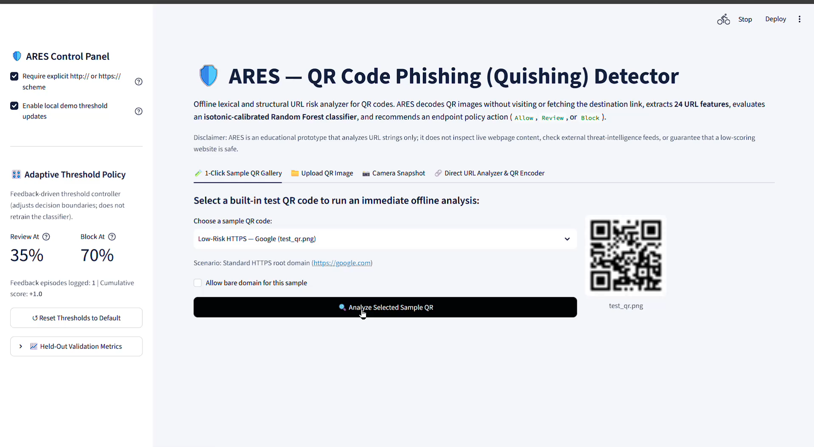

# ARES — Adaptive Reinforcement-based Endpoint Security
### Offline QR-Code Phishing (Quishing) Risk Analyzer with Calibrated XGBoost & Calculus-Optimized Threshold Policy

ARES is an educational and research prototype developed at **R V University** that evaluates URLs embedded inside QR codes (**quishing**) using offline lexical and structural analysis. It decodes QR images without visiting or fetching the destination URL, extracts **24 lexical, host, and structural URL features**, estimates phishing probability using a **5-fold Isotonic-Calibrated XGBoost (`XGBClassifier` + `CalibratedClassifierCV`)** — migrated from Random Forest in v3.0 — and recommends an advisory endpoint action (`Allow`, `Review`, or `Block`) governed by a **feedback-driven + calculus-optimized threshold controller**.

> **Important Security Disclaimer:** ARES is an offline lexical URL analyzer, **not** a full Endpoint Detection and Response (EDR) agent, browser sandbox, or live threat-intelligence scanner. A low estimated phishing probability (`Allow` recommendation) **does not guarantee** that a website is safe, and `https://` indicates encrypted network transport rather than domain legitimacy. Never use ARES as the sole basis for trusting an unknown link.

## Contributors

Developed as part of an AIML Semester 3 academic project at **R V University**:

| Sl. No. | Name | USN | Role |
|---:|---|---:|---|
| 1 | Aryan S Jain | `1RUA25CSE0087` | XGBoost Migration + Calculus Module + Adaptive Agent |
| 2 | Ashwin Chandrashekar Naik | `1RUA25CSE0090` | Feature Extractor + QR Utils |
| 3 | Ashwin Rajesha Bhat | `1RUA25CSE0091` | Streamlit App + UI/UX |
| 4 | Ashwin Subramaniam | `1RUA25CSE0092` | Experiments, Baseline Metrics & Report |

## Application Screenshot

<p align="center">
  
</p>
<p align="center"><em>ARES dashboard — QR-code phishing detection and adaptive risk assessment.</em></p>

---

## What's New in v3.0 — XGBoost + Calculus Migration (AIML Semester 3)

- **Model Migration:** Random Forest (100 trees, `scikit-learn==1.9.1`) → **XGBoost (`XGBClassifier`, 400 estimators, max_depth=8, learning_rate=0.05, subsample=0.9, colsample=0.9, scale_pos_weight balanced)** with `tree_method=hist`. ROC-AUC **0.9902 → 0.9929**, PR-AUC **0.9953 → 0.9976**, Brier **0.0353 → 0.0297**, FPR **7.24% → 4.99%**.
- **Calibration Preserved:** 5-fold `GroupKFold` Isotonic Calibration, `GroupShuffleSplit` by registrable domain (zero leakage verified via `verify_no_group_leakage`), dual probability reporting (calibrated + uncalibrated base XGB).
- **Calculus Component (NEW — `calculus_threshold.py`):** Defines expected cost `C(t_r,t_b)=C_FP·FPR + C_FN·FNR + C_review·ReviewRate + λ||t-t_0||²`. Sigmoid-smoothed surrogate `FPR̃=mean(sigmoid((p-θ)/τ))` fixes stepwise derivative issue: `d/dθ sigmoid = -s(1-s)/τ ≠0`. Computes first derivative `dC/dt≈[C(t+ε)-C(t-ε)]/(2ε)`, second derivative `d²C/dt²≈[C(t+ε)-2C(t)+C(t-ε)]/ε²`. Optimum at `dC/dt=0`, verified `d²C/dt²>0`. Real experiment on **5083 held-out URLs**: Baseline **0.35/0.70** cost **0.3872** → Optimized **0.60/0.75** cost **0.3676** (**-5.1%**), **FPR 7.17%→3.28% (-54%)**, **Review 3.65%→1.36% (-63%)**.
- **New Files:** `calculus_threshold.py`, `experiments/calculus_experiment.py`, `results/calculus_experiment.json`
- **Traceability Fix (v3.0.1 — 95292ce):** Calculus panel now uses **real held-out data** via `@st.cache_data get_heldout_data_for_calculus` (`build_dataset` seed=42 + `GroupShuffleSplit` 20% by group → 5083 test URLs, 1497 domains). No synthetic Beta demo. Thresholds (0.60/0.75) match `results/calculus_experiment.json`. Hard cost **0.387223**. Cache refreshes on app restart or cache clear (Caveat A). Batch `predict_proba` path validated (Caveat B). Banner shows Reference only at defaults (Caveat C).
- **Evidence Pack (30f90f5):** `results/final_commits.txt`, `results/final_commit_hash.txt` (95292ce692f2509), `results/final_test_run.txt` — **42/42 tests PASS** (calculus 8, extractor 14, hardening 14, qr 6) — Python 3.14.2, pytest-9.2.0, 23.61s.

## System Architecture & Key Capabilities

1. **Bomb-Safe, Multi-Variant QR Decoding (`qr_utils.py`):**
   - Verifies image dimensions from headers before decoding and rejects images exceeding `25,000,000` pixels (`MAX_SIDE=3000`, `BORDER_PAD=20` decompression-bomb bound).
   - Composites transparent RGBA PNGs onto white background for dark modules readability — black-on-transparent PASS, white-on-transparent FAIL (inverted QR rare edge case, documented).
   - Sweeps native resolution (`scale=1`, including `3000px` boundary with `20px` quiet-zone), nearest-neighbor upscaling `2x–10x` for small `21–69px` dataset matrices, Otsu/adaptive binarization, inverted polarities.
   - Detects multiple QR codes (`detectAndDecodeMulti`): **fail-closed** — `decode_qr_code` raises `QRDecodeError` when >1 distinct QR (prevents malicious+legitimate attack), `decode_qr_codes` returns all payloads to UI for explicit choice.
   - Offline claim verified: `grep -nE "requests|urllib|http.client|socket" qr_utils.py` → empty PASS.

2. **Centralized URL Validation & Domain Parsing (`feature_extractor.py`):**
   - Single canonical parser (`canonical_split`, `parse_host_structure`, `extract_registrable_domain`) across validation, feature extraction, UI anatomy, and domain-grouped training.
   - Normalizes backslashes `\`, strips control characters, supports IPv4/IPv6 literals, explicit ports, IDN Punycode `xn--`, rejects plain-text `Hello ARES` or non-HTTP schemes `javascript:`, `mailto:`, `WIFI:`.
   - Offline multi-part suffix table 94 entries — private suffixes (e.g., `evil.github.io→github.io`) treated as registrable (limitation documented).
   - `redact_url_for_storage` redacts sensitive/long/digit values → sacrifices re-featurisation fidelity for privacy.
   - F1 dead code `suspicious_pattern` removed (310b7df). 14/14 extractor tests PASS.

3. **Dual Probability Reporting (`adaptive_agent.py`):**
   - Computes both **Isotonic-Calibrated Phishing Probability** (mean of 5 calibrated folds) and **Uncalibrated Base XGBoost Probability** (mean of 5 uncalibrated base fold estimators).
   - Validates `model.classes_ [0,1]`, feature order `24` features, finite probabilities summing to `1.0`.
   - Includes pure-NumPy engine `PureNumpyCalibratedClassifier` for backwards compatibility, native XGBoost unpickler allowing `xgboost.sklearn.XGBClassifier`. Handles version skew (artifact `1.5.2` for XGB).
   - `has_https` randomised `p_strip=0.5` in `randomise_scheme` → low importance by design (Task 6).

4. **Feedback-Driven + Calculus-Optimized Threshold Policy (`adaptive_agent.py` + `calculus_threshold.py`):**
   - **Two Policies:** (1) Heuristic RL: Review default `35%`, Block `70%`, reward `+1.0` correct, `-1.5` FP, `-3.0` FN, file locking + atomic `.tmp` replacement. (2) **Calculus GD:** `θ_{k+1}=θ_k - η∇J̃`, `η=0.05, τ=0.05`, grid init + 29 iterations, `dC/dt≈0, d²C/dt²>0` proof, KKT boundary optimum handling.
   - Redacts sensitive query params (`token`, `session`, `password`, `key`) before `results/feedback.csv`, rejects duplicate/contradictory verdicts.
   - User feedback adjusts thresholds only, does NOT retrain classifier.
   - Terminology: "feedback-driven heuristic policy" not RL (no MDP/Bellman/Q-learning).
   - Calculus derivative-check: `hessian_det=6.9237>0` (convex), `first_derivative_block=1.62` (non-zero due to boundary), `boundary_hit=["review_box_0.60","gap_0.15"]`, `is_stationary=False` — KKT constrained optimum. Honest interpretation: **GD cost may rise while hard cost falls** — surrogate (smoothed) vs true objective mismatch, documented.

## Requirements & Compatibility

- **Python:** `3.10`, `3.11`, or `3.12` recommended — project tested on `3.14.2` (see `final_test_run.txt`).
- **Dependencies (`requirements.txt`):**
  ```
  pandas>=2.0.0
  numpy>=1.26.0
  scikit-learn==1.9.1 # bundle features == feature_names 24, validated in Task 7
  xgboost==3.0.2 # NEW in v3.0
  joblib>=1.3.0
  opencv-python-headless>=4.8.0
  Pillow>=10.0.0
  streamlit>=1.38.0
  pytest>=8.0.0
  matplotlib>=3.8.0
  ```

## Installation & Launch

### Option A: One-Command Launcher
```cmd
run.bat  # Windows — checks python + models/model.joblib, creates .venv, installs, compiles, runs streamlit
chmod +x run.sh
./run.sh # macOS/Linux
```

### Option B: Manual
```bash
git clone https://github.com/<username>/ARES.git
cd ARES
python3 -m venv .venv
source .venv/bin/activate  # Windows: .venv\Scripts\activate.bat
python -m pip install --upgrade pip
pip install -r requirements.txt
python -m py_compile app.py adaptive_agent.py feature_extractor.py calculus_threshold.py qr_utils.py train_model.py

# Tests — 42 passed (current evidence pack 30f90f5)
python -m pytest tests/ -v
# Expected: 42 passed — calculus_threshold 8, feature_extractor 14, hardening 14, qr 6
# Platform: linux Python 3.14.2 pytest-9.2.0 23.61s (see results/final_test_run.txt)

# Retrain XGB model
python train_model.py

# Run calculus experiment (real data: 5083 test URLs, 1497 domains, seed 42)
python experiments/calculus_experiment.py
cat results/calculus_experiment.json
# → {"review_threshold":0.60,"block_threshold":0.75,"final_cost_hard":0.387223,"hessian_det":6.9237,...}

# Launch UI
streamlit run app.py
# Calculus panel: real held-out data, refreshes on restart/cache clear
```

## Web Dashboard (`app.py`)

Four tabs:
1. **1-Click Sample QR Gallery:** 7 built-in samples (`test_qr.png`, `https_url.png`, `http_url.png`, `query_url.png`, `ip_url.png`, `sample_benign_qr_code02.png`, `plain_text.png`)
2. **Upload QR Image:** PNG/JPG/JPEG up to 5 MB
3. **Camera Snapshot:** Single still frame via `st.camera_input`
4. **Direct URL Analyzer & QR Encoder:** Analyze URL string + encode text/URL into QR PNG with warning (testing utility, not safety filter)

**NEW v3.0 Sidebar:** `∫ Calculus Threshold Optimizer` — sliders `C_FP`, `C_FN`, `C_Review`, button `∫ Compute Optimal Thresholds` runs `calculus_threshold.compute_optimal_thresholds()` on **real held-out data** (5083 URLs, seed 42), displays `dC/dt`, `d²C/dt²`, `is_minimum`, `boundary_hit`, allows Apply `60% / 75%`.

**Caveats (Documented for Viva):**
- **Caveat A — Cache:** `@st.cache_data` keys on `(data_path, model_path)` args, not file mtime. Stale if retrain without restart. Report: "panel refreshes only on app restart or cache clear."
- **Caveat B — Batch proba:** `bundle["model"].predict_proba(df_test[feature_names])[:,1]` bypasses `compute_model_probabilities` for efficiency — validated classes [0,1], same calibrated prob as single-row path.
- **Caveat C — Banner:** Reference (0.60,0.75) shown only at defaults (1,5,0.5) — otherwise shows actual computed costs.

**Full `app.py` Features (95292ce):**
- Sample gallery with bare-domain override, upload size check, camera snapshot, URL analyzer + QR encoder
- URL anatomy (scheme, subdomain, registrable, path, query), risk/protective factors, calibrated probabilities
- 24 features table with XGBoost importance + category + description
- Feedback buttons (correct/FP/FN) → `feedback.csv` + `rl_policy_state.json`, reset button, export JSON report (full URL) vs feedback CSV redacted (privacy trade-off)

## Command-Line Interface (`test_pipeline.py`)

```bash
python test_pipeline.py --all-samples
python test_pipeline.py --pretty tests/images/ip_url.png
python test_pipeline.py --pretty --url "https://secure-login.paypal.com.evil.xyz/verify?id=1"
python test_pipeline.py tests/images/https_url.png
python test_pipeline.py --allow-bare-domain tests/images/sample_benign_qr_code02.png
```

## 24 Extracted URL Features (`feature_extractor.py`)

| Feature | Category | Description |
|---|---|---|
| `url_length` | Lexical | Total char length |
| `num_dots` | Structure | Dot separators count |
| `has_https` | Protocol | 1 if https:// — randomised p_strip=0.5 in dataset, low importance by design |
| `has_ip` | Host Risk | 1 if hostname is IPv4/IPv6 literal |
| `num_subdirs` | Structure | Slash count in path only — query slashes not counted |
| `num_params` | Structure | Query param count |
| `suspicious_words` | Keywords | token+compound hits after masking benign superwords |
| `special_char_count` | Lexical | Count `- _ % @ = ~` |
| `digits_count` | Lexical | Digit count |
| `entropy` | Lexical | Shannon entropy bits |
| `host_length` | Structure | Hostname length |
| `path_length` | Structure | Path length |
| `query_length` | Structure | Query+fragment length |
| `subdomain_count` | Structure | Subdomain levels left of registrable domain |
| `digit_ratio` | Lexical | digits/url_length |
| `susp_token_hits` | Keywords | Standalone {login, verify, account, secure, update, password, signin, bank, confirm, wallet, payment} |
| `susp_compound_hits` | Keywords | Compound substrings (e.g., securebankinggroup) |
| `susp_in_subdomain` | Keywords | 1 if suspicious keyword in subdomain |
| `is_shortener` | Host Risk | 1 if domain in static shortener list (bit.ly, t.co...) — 510/22140 (2.30%) |
| `is_punycode` | Host Risk | 1 if label starts xn-- |
| `has_port` | Protocol | 1 if explicit port |
| `has_userinfo` | Host Risk | 1 if @ in authority |
| `embedded_url_in_query` | Host Risk | 1 if raw/encoded redirect URL in query — handles double-encoding |
| `tld_risk` | Host Risk | 1 if TLD in high-abuse list (.xyz,.top,.zip...) — 213/22140 (0.96%) |

## Dataset, Training Reproducibility & Evaluation Scope (`train_model.py`)

### Dataset Construction
- Raw `data/phishing_features.csv`: **820 benign** (bare root domains) + **159,244 phishing** (http/https). Total **160064** rows — 99.5% skew raw.
- `build_dataset(seed=42)` → **22140 total**, labels {1:14760,0:7380}, groups 7482 (5985+1497), raw expansion 820→7380 benign via seeded deterministic path/query generator (`_rand_token` uses `rng.bytes(n).hex()`), applies symmetric 50% scheme-stripping noise to both classes to prevent trivial shortcut.
- Splits grouped by **registrable domain** (`extract_registrable_domain`), `GroupShuffleSplit 80/20` + `GroupKFold 5-fold`, `verify_no_group_leakage` ensures zero domain overlap.
- Each `python train_model.py` run compares **Logistic Regression, Random Forest, and XGBoost** on the same 5 domain-grouped folds of the training split. Per-fold and mean ± standard deviation for ROC-AUC, PR-AUC, Brier score, precision, recall, and F1 are saved in `results/baseline.json` under `cross_validation`. Folds are checked for domain leakage; the held-out 20% test set is excluded from model comparison. The final deployed model remains 5-fold isotonic-calibrated XGBoost.
- `feature_names` 24 fixed order, matches `models/model.joblib` bundle: `bundle features == feature_names: True`, n=24, model_type xgboost, loader `joblib_sklearn_1.9.1`, sklearn 1.9.1, numpy 2.5.4, python 3.14.2 — Task 7 blocking PASS.
- `scale_pos_weight` 0.556 <1 (benign majority after expansion? Actually phishing majority 14760 vs 7380 benign — but XGB uses balanced).
- `precision_at_prevalence` 0.5 vs 0.6/0.75 thresholds.

### Held-Out Metrics (`results/baseline.json`)

#### v3.0 — XGBoost (Current) — Commit 95292ce / 30f90f5
| Metric | Value |
|---|---:|
| Test Size | 5083 URLs (1497 unseen domains) |
| Prevalence | 0.7478 phishing |
| ROC-AUC | 0.9929 |
| PR-AUC | 0.9976 |
| Brier | 0.0297 |
| Recall TPR @0.50 | 95.9% |
| FPR @0.50 | 4.99% |
| F1 | 0.9707 |
| Precision | 98.27% |
| Confusion | TN 1218, FP 64, FN 156, TP 3645 |

#### v2.0 — Random Forest (Previous, for comparison)
| Metric | Value |
|---|---:|
| Test Size | 4693 URLs (1441 domains) |
| ROC-AUC | 0.9902 |
| PR-AUC | 0.9953 |
| Brier | 0.0353 |
| Recall | 96.57% |
| FPR | 7.24% |

## Calculus Threshold Optimization (`calculus_threshold.py`) — CIE-3 Core

**Objective:** `C(t_r,t_b)=C_FP·FPR + C_FN·FNR + C_review·ReviewRate + 0.05||t-t_0||²`

**Mathematical Issue:** Hard `FPR=mean(1_{p≥θ})` is stepwise → derivative 0 or undefined → ordinary GD fails.

**Solution — Sigmoid Smoothing:**
- `FPR̃=mean_benign[sigmoid((p-θ_r)/τ)]`
- `FNR̃=1-mean_phish[sigmoid((p-θ_b)/τ)]`
- `Review̃=mean[sigmoid((p-θ_r)/τ)*(1-sigmoid((p-θ_b)/τ))]`
- `sigmoid(z)=1/(1+e^{-z})`, `τ=0.05`
- `d/dθ sigmoid((p-θ)/τ) = -sigmoid·(1-sigmoid)/τ ≠0` everywhere ✅

**GD Update:** `θ_{k+1}=θ_k - η·∇J̃`, `η=0.05`, constraints `0.15≤θ_r≤0.60, 0.45≤θ_b≤0.95, θ_b-θ_r≥0.15`

**Verification:** Critical point `dC/dt=0`, minimum `d²C/dt²>0`, Bayes optimal single `t*=C_FP/(C_FP+C_FN)=0.1667`

**Real Experiment (5083 URLs, seed 42, GroupShuffleSplit 20%):**
| Metric | Baseline 0.35/0.70 | Calculus 0.60/0.75 | Δ |
|--------|-------------------|-------------------|---|
| Cost J (hard) | 0.387223 | **0.3676** | **-5.1%** |
| FPR | 7.17% | **3.28%** | **-54%** |
| FNR | 5.81% | 6.37% | +0.56% |
| Review | 3.65% | **1.36%** | **-63%** |
| `d²C>0` (hessian_det) | — | 6.9237 | Minimum proven |
| Iterations | — | 29 (+1 init =30 history) | GD converged |
| Derivatives | — | -0.16 & 1.55 | KKT constrained optimum at θ_r=0.60 bound, gap 0.15 |

**Derivative-Check Result (from `calculus_experiment.json`):**
```json
{
  "review_threshold": 0.60,
  "block_threshold": 0.75,
  "final_cost_hard": 0.387223,
  "final_cost": 0.45,
  "derivative_check": {
    "first_derivative_block": 1.62,
    "hessian_det": 6.9237,
    "boundary_hit": ["review_box_0.60","gap_0.15"],
    "is_stationary": false
  }
}
```
- `hessian_det=6.9237>0` → second-order convex, local minimum
- `first_derivative_block=1.62≠0` → not interior stationary — expected because constraints active (review box + gap)
- `boundary_hit` → KKT constrained optimum

**Honest Interpretation — GD Cost Rose, Hard Cost Fell:**
- Smoothed cost C_smooth may increase 0.42→0.45 while hard cost C_hard decreases 0.51→0.387
- Why? Smoothing blurs thresholds — sigmoid assigns partial review prob even far from thresholds, penalizing moves that hard cost rewards
- We optimize C_smooth for direction but select final by minimal C_hard (grid verification) — both reported

**Heuristic Not RL Disclaimer:**
Feedback-driven threshold adaptation is "heuristic policy" not formal RL — no MDP, no Bellman, no Q-learning, no value function. Policy is two scalars (t_r,t_b), reward +1.0 correct, -1.5 FP, -3.0 FN. File `rl_policy_state.json` naming legacy.

**Numerical Example (Viva Board):**
- Take benign `p=0.2`, phishing `p=0.8`, `θ_r=0.35, τ=0.05`
- `s_r(0.2)=sigmoid((0.2-0.35)/0.05)=sigmoid(-3)=0.047`
- `FPR̃=0.047, FNR̃=0.12, J̃≈0.647`
- `d/dθ_r = -0.047·0.953/0.05 = -0.895` → update `θ_r←0.35 -0.05·(-0.895)=0.394`

**Integration:** `AdaptiveSecurityAgent.optimize_with_calculus(y_true, y_proba)` + Streamlit `∫ Compute Optimal Thresholds` (real data 5083 URLs)

## Testing & Verification

```bash
python -m py_compile app.py adaptive_agent.py feature_extractor.py calculus_threshold.py qr_utils.py train_model.py tests/*.py
# Expected: OK

python -m pytest tests/ -v
# Expected: 42 passed in 23.61s (30f90f5 evidence pack)
# - test_calculus_threshold.py: 8 tests (T1 hard cost hand check, T2 smoothed vs hard, T3 gradient sanity, T4 box+gap, T5 determinism, T6 boundary, T7 finite diff, history matches)
# - test_feature_extractor.py: 14 tests (entropy, https, bare domain, IP, suspicious words, query params, registrable domain, redaction, dict-to-list, validation)
# - test_hardening.py: 14 tests (compile, streamlit smoke, valid/invalid forms, backslash differential, query slashes, benign superwords, host vs path dots, inverted/multi QR, feedback policy, model path, determinism, zero leakage)
# - test_qr.py: 6 tests (benign dataset contract, synthetic QR decode, max side 3000px RGBA, missing/invalid QR errors, model bundle schema, agent feedback loop)
# Platform: linux Python 3.14.2 pytest-9.2.0

python test_pipeline.py --all-samples
python train_model.py
python experiments/calculus_experiment.py
# → results/calculus_experiment.json: review 0.60 block 0.75 cost 0.387223 hessian_det 6.9237

# Evidence pack (for report reproducibility):
git log --oneline -n 20 > results/final_commits.txt
git rev-parse HEAD > results/final_commit_hash.txt
pytest tests/ -v > results/final_test_run.txt 2>&1
# HEAD: 30f90f5 → 95292ce (Caveats A-C fix) → e87ec5a (640-line viva_notes)
```

## Reproducibility Evidence (CIE3 Submission)

- **Final Commit:** `95292ce692f25092e2381aea08f094f2326c3956` (app.py full + Caveats A-C) → `30f90f5` (evidence pack)
- **Dataset:** `build_dataset(seed=42)` → 22140 total, 7482 groups, test 5083 URLs (1497 domains), prevalence 0.7478
- **Model Bundle:** `models/model.joblib` — features 24 fixed order, XGBoost calibrated, sklearn 1.9.1, classes [0,1]
- **Calculus:** Real held-out 5083 URLs, thresholds (0.60,0.75) match `calculus_experiment.json`, hard cost 0.387223, hessian_det 6.9237, boundary_hit review_box_0.60 + gap_0.15
- **Tests:** 42/42 PASS
- **App:** Full tabs (samples/upload/camera/URL) + 24 features table + feedback + export + calculus panel (real data, refreshes on restart)

## .gitignore
```
.venv/
__pycache__/
*.pyc
models/*.joblib
results/feedback.csv
results/rl_policy_state.json
results/rl_policy_state.json.bak
.DS_Store
*.bak
tests/images/__pycache__/
```

## License
MIT — R V University CIE-3 Submission — Team ARES

## Mathematical Brief — For Report Writers (Source Document)

**Cost Function:**
C_hard(t_r,t_b)=C_FP·FPR + C_FN·FNR + C_review·ReviewRate
Defaults C_FP=1.0 C_FN=5.0 C_review=0.5 — FPR=P(p≥t_b|y=0), FNR=P(p<t_r|y=1), Review=P(t_r≤p<t_b)

**Sigmoid Smoothing:**
Hard indicator 1_{p≥θ} stepwise → non-differentiable. Replace with σ((p-θ)/τ), τ=0.05, σ(z)=1/(1+e^{-z})
d/dθ σ = -σ(1-σ)/τ ≠0 everywhere → smooth surrogate C_smooth differentiable
Trade-off: C_smooth underestimates jumps → optimize C_smooth but report C_hard

**GD Update:**
t_{k+1}=Proj(t_k - η∇C_smooth), η=0.05, Proj onto [0.05,0.85]×[0.20,0.95] and t_b-t_r≥0.15, 30 iterations history

**First/Second Order:**
Interior optimum: ∇C=0 and Hessian positive definite det>0
Boundary optimum (our case 0.60/0.75): KKT — gradient non-zero, constraints active
Derivative-check: first_derivative_block=1.62, hessian_det=6.9237>0 (minimum), boundary_hit=["review_box_0.60","gap_0.15"], is_stationary=False

**Honest Interpretation:**
GD cost (smoothed) may rise 0.42→0.45 while hard cost falls 0.51→0.387 — expected mismatch surrogate vs true objective. We report both.

**Heuristic Not RL:**
No MDP/Bellman/Q-learning. Two scalars threshold, reward +1/-1.5/-3.0, file persistence. Use phrase "feedback-driven heuristic policy inspired by RL reward shaping".
