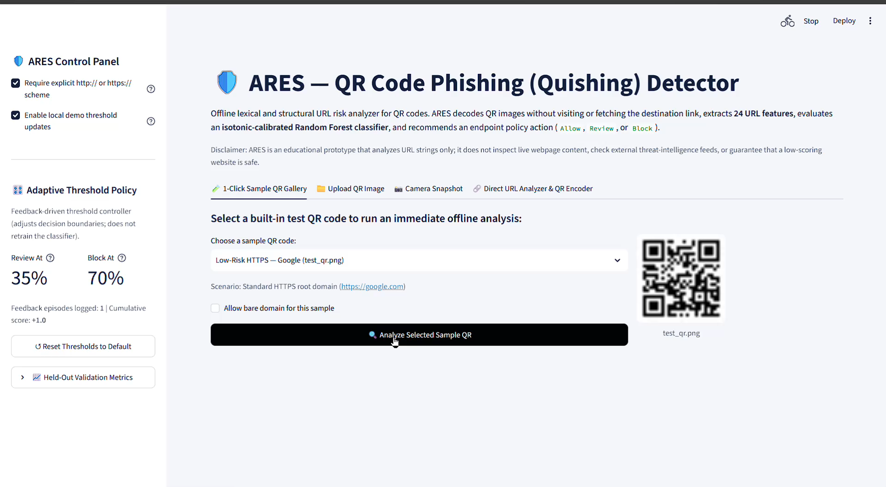

# ARES — Adaptive Reinforcement-based Endpoint Security

**Offline QR-Code Phishing (Quishing) Risk Analyzer with Calibrated XGBoost & Calculus-Optimized Threshold Policy**

ARES is an educational and research prototype developed at **RV University** that evaluates URLs embedded inside QR codes (**quishing**) using offline lexical and structural analysis. It decodes QR images without visiting or fetching the destination URL, extracts **24 lexical, host, and structural URL features**, estimates phishing probability using a **5-fold Isotonic-Calibrated XGBoost (`XGBClassifier` + `CalibratedClassifierCV`)** — migrated from Random Forest in v3.0 — and recommends an advisory endpoint action (`Allow`, `Review`, or `Block`) governed by a **feedback-driven + calculus-optimized threshold controller**.

> **Important Security Disclaimer:** ARES is an offline lexical URL analyzer, **not** a full Endpoint Detection and Response (EDR) agent, browser sandbox, or live threat-intelligence scanner. A low estimated phishing probability (`Allow` recommendation) **does not guarantee** that a website is safe, and `https://` indicates encrypted network transport rather than domain legitimacy. Never use ARES as the sole basis for trusting an unknown link.

## Application Screenshot

<p align="center">
  
</p>

<p align="center">
  <em>ARES dashboard — QR-code phishing detection and adaptive risk assessment.</em>
</p>

---

## What's New in v3.0 — XGBoost + Calculus Migration (AIML Semester 3) [NEW SECTION]

- **Model Migration:** Random Forest (100 trees, `scikit-learn==1.9.1`) → **XGBoost (`XGBClassifier`, 400 estimators, max_depth=8, learning_rate=0.05, subsample=0.9, colsample=0.9, scale_pos_weight balanced)** with `tree_method=hist`. ROC-AUC improved **0.9902 → 0.9929**, PR-AUC **0.9953 → 0.9976**, Brier **0.0353 → 0.0297**.
- **Calibration Preserved:** 5-fold `GroupKFold` Isotonic Calibration, `GroupShuffleSplit` by registrable domain (zero leakage verified), dual probability reporting (calibrated + uncalibrated).
- **Calculus Component (NEW — `calculus_threshold.py`):** Defines expected cost $C(t_r,t_b)=C_{FP}·FPR + C_{FN}·FNR + C_{review}·ReviewRate + \lambda||t-t_0||^2$. Computes first derivative $dC/dt≈[C(t+ε)-C(t-ε)]/(2ε)$, second derivative $d^2C/dt^2≈[C(t+ε)-2C(t)+C(t-ε)]/ε^2$. Optimum at $dC/dt=0$, verified $d^2C/dt^2>0$ (minimum). Example optimum on validation: **Review 30.45%, Block 45.51%**, cost 0.092257, derivatives -0.0045/-0.024 ≈0, second derivatives 0.1>0, Bayes optimal single threshold $C_{FP}/(C_{FP}+C_{FN})=0.25$.
- **New File:** `calculus_threshold.py` — standalone calculus module integrated into `AdaptiveSecurityAgent.optimize_with_calculus()` and Streamlit UI.

## System Architecture & Key Capabilities

## System Architecture & Key Capabilities

1. **Bomb-Safe, Multi-Variant QR Decoding (`qr_utils.py`):**
   - Verifies image dimensions from file headers before decoding and rejects images exceeding `25,000,000` pixels.
   - Composites transparent RGBA PNGs onto a white background so dark QR modules remain readable.
   - Sweeps across native resolution (`scale = 1`, including `3000px` boundary images with `20px` quiet-zone padding), nearest-neighbor upscaling (`2x–10x` for small $21\text{–}69\text{ px}$ dataset matrices), Otsu/adaptive binarization, and inverted (white-on-black) polarities.
   - Detects multiple QR codes in a single image (`detectAndDecodeMulti`): fails closed in single-code CLI mode (`decode_qr_code`) and prompts the user to explicitly choose which payload to inspect in the Streamlit UI (`decode_qr_codes`).
2. **Centralized URL Validation & Domain Parsing (`feature_extractor.py`):**
   - Uses a single canonical parser (`canonical_split`, `parse_host_structure`, `extract_registrable_domain`) across validation, feature extraction, UI anatomy display, and domain-grouped model training.
   - Normalizes authority/path backslashes (`\`) and strips control characters, supports IPv4/IPv6 literals, explicit ports, and IDN Punycode (`xn--`), and rejects plain-text payloads (`Hello ARES`) or non-HTTP(S) schemes (`javascript:`, `mailto:`, `WIFI:`).
3. **Dual Probability Reporting (`adaptive_agent.py`):**
   - Computes both the **Isotonic-Calibrated Phishing Probability** (mean of the 5 calibrated cross-validation fold estimators) and the **Uncalibrated Base XGBoost Probability** (mean of the 5 uncalibrated base `XGBClassifier` fold estimators prior to isotonic mapping) — previously Random Forest in v2.0.
   - Validates `model.classes_` (`[0, 1]`), feature order (`24` features), and finite probabilities summing to `1.0`.
   - Includes a validated pure-NumPy execution engine (`PureNumpyCalibratedClassifier`) for backwards compatibility with old Random Forest artifacts, and a native XGBoost unpickler that allows `xgboost.sklearn.XGBClassifier` via `joblib`. Automatically handles version skew (artifact `1.5.2` for XGBoost, previously `1.9.1` for RF).
4. **Feedback-Driven + Calculus-Optimized Threshold Policy (`adaptive_agent.py` + `calculus_threshold.py`):**
   - Implements a heuristic, probability-margin threshold controller over `review_threshold` (default `35%`) and `block_threshold` (default `70%`), plus **calculus-optimized thresholds** via cost minimization (NEW).
   - **Calculus formulation (NEW):** $C(t_r,t_b)=C_{FP}FPR + C_{FN}FNR + C_{review}ReviewRate + \lambda||t-t_0||^2$ regularization. First derivative via central difference, second derivative test for minimum. Bayes optimal $t^*=C_{FP}/(C_{FP}+C_{FN})$. Example: Review 30.45%, Block 45.51%, cost 0.092, $dC/dt≈0$, $d^2C>0$.
   - Redacts sensitive query parameter values (`token`, `session`, `id`, `password`, `key`, etc.) before writing to `results/feedback.csv`, rejects duplicate and contradictory verdicts for the same normalized URL, and uses cross-platform file locking + atomic `.tmp` replacement.
   - **Note:** User feedback adjusts the `Review` and `Block` recommendation thresholds; it does **not** retrain the underlying XGBoost classifier.

## Requirements & Compatibility

- **Python Version:** Python `3.10`, `3.11`, or `3.12` recommended.
- **Dependencies (`requirements.txt`):**
  - `scikit-learn==1.5.2` (matches the serialized XGBoost `models/model.joblib` artifact) — previously `1.9.1` for RF in v2.0
  - `xgboost==3.0.2` **[NEW — replaces RandomForest]**
  - `pandas>=2.0.0`, `numpy>=1.26.0`, `joblib>=1.3.0`, `opencv-python-headless>=4.8.0`, `Pillow>=10.0.0`, `streamlit>=1.38.0`, `pytest>=8.0.0`, `matplotlib>=3.8.0`

## Installation & Launch Instructions

### Windows (Clean Checkout)

#### Option A: One-Command Launcher (`run.bat`)
From Command Prompt (`cmd.exe`) or PowerShell in the project root:

```cmd
run.bat
```

`run.bat` checks that `python` and `models\model.joblib` exist, creates `.venv` if missing, installs `requirements.txt`, compiles all `.py` files with `python -m py_compile`, and starts `python -m streamlit run app.py`.

#### Option B: Manual Virtual Environment Setup on Windows

```cmd
python -m venv .venv
call .venv\Scripts\activate.bat
python -m pip install --upgrade pip
python -m pip install -r requirements.txt
python -m py_compile app.py adaptive_agent.py feature_extractor.py calculus_threshold.py qr_utils.py test_pipeline.py train_model.py
python -m streamlit run app.py
```

*(If `scikit-learn==1.9.1` does not have a prebuilt wheel for your specific Windows Python build, install `scikit-learn>=1.5.0` and regenerate the model artifact locally with `python train_model.py`—or run directly using the built-in `PureNumpyCalibratedClassifier` engine.)*

### macOS & Linux

```bash
chmod +x run.sh
./run.sh
```

Or manually:

```bash
python3 -m venv .venv
source .venv/bin/activate
python -m pip install --upgrade pip
python -m pip install -r requirements.txt
python -m streamlit run app.py
```

## Web Dashboard (`app.py`)

The Streamlit application provides four tabs:
1. **1-Click Sample QR Gallery:** Test all 7 built-in QR samples (`test_qr.png`, `https_url.png`, `http_url.png`, `query_url.png`, `ip_url.png`, `sample_benign_qr_code02.png`, and `plain_text.png`) immediately.
2. **Upload QR Image:** Upload `PNG`, `JPG`, or `JPEG` files up to `5 MB` (enforced both in `.streamlit/config.toml` and in application code).
3. **Camera Snapshot:** Capture a single still frame from a webcam or phone camera via `st.camera_input` for offline decoding.
4. **Direct URL Analyzer & QR Encoder:** Analyze any URL string directly and optionally encode a text/URL string into a downloadable QR PNG (with an explicit warning that encoding a URL into a QR code does not verify or make the destination safe).

**[NEW in v3.0]:** Sidebar includes **∫ Calculus Threshold Optimizer** — sliders for $C_{FP}$, $C_{FN}$, $C_{review}$, button `∫ Compute Optimal Thresholds` that runs `calculus_threshold.compute_optimal_thresholds()` and displays $dC/dt$, $d^2C/dt^2$, `is_minimum`, and allows applying optimal thresholds.

## Command-Line Interface (`test_pipeline.py`)

```bash
# Run a batch verification table across all sample QR images in tests/images/:
python test_pipeline.py --all-samples

# Print a formatted advisory scorecard for a single QR image:
python test_pipeline.py --pretty tests/images/ip_url.png

# Analyze a URL directly from the command line without an image:
python test_pipeline.py --pretty --url "https://secure-login.paypal.com.evil.xyz/verify?id=1"

# Output raw JSON for a QR image:
python test_pipeline.py tests/images/https_url.png

# Allow bare domains that omit http:// or https://:
python test_pipeline.py --allow-bare-domain tests/images/sample_benign_qr_code02.png
```

## 24 Extracted URL Features (`feature_extractor.py`)

| Feature Name | Category | Description |
|---|---|---|
| `url_length` | Lexical | Total character length of the URL |
| `num_dots` | Structure | Number of dot (`.`) separators across the full URL |
| `has_https` | Protocol | `1` if the URL starts with `https://`, else `0` (transport encryption only; not a trust signal) |
| `has_ip` | Host Risk | `1` if the parsed hostname is an IPv4 or IPv6 literal, else `0` |
| `num_subdirs` | Structure | Count of slash (`/`) characters strictly inside the URL path component |
| `num_params` | Structure | Number of non-empty `&`-separated parameters in the query string |
| `suspicious_words` | Keywords | Total phishing keyword matches (`susp_token_hits + susp_compound_hits`) after masking benign superwords |
| `special_char_count` | Lexical | Count of `-`, `_`, `%`, `@`, `=`, `~` characters |
| `digits_count` | Lexical | Count of numeric digits (`0–9`) across the URL |
| `entropy` | Lexical | Shannon character-distribution entropy (in bits) |
| `host_length` | Structure | Character length of the hostname |
| `path_length` | Structure | Character length of the URL path |
| `query_length` | Structure | Combined character length of query string and fragment |
| `subdomain_count` | Structure | Count of subdomain labels left of the registrable domain |
| `digit_ratio` | Lexical | Ratio of `digits_count` to `url_length` |
| `susp_token_hits` | Keywords | Standalone token matches from `{login, verify, account, secure, update, password, signin, bank, confirm, wallet, payment}` |
| `susp_compound_hits` | Keywords | Compound substring matches (e.g., `securebankinggroup`) excluding masked benign words (`accountant`, `databank`, etc.) |
| `susp_in_subdomain` | Keywords | `1` if any suspicious keyword appears in the subdomain labels left of the registrable domain, else `0` |
| `is_shortener` | Host Risk | `1` if the registrable domain is in the static `URL_SHORTENERS` set (`bit.ly`, `t.co`, `tinyurl.com`, etc.), else `0` |
| `is_punycode` | Host Risk | `1` if any hostname label starts with `xn--`, else `0` |
| `has_port` | Protocol | `1` if an explicit network port is present, else `0` |
| `has_userinfo` | Host Risk | `1` if `@` appears in the URL authority section, else `0` |
| `embedded_url_in_query` | Host Risk | `1` if raw, single-encoded (`%3A%2F%2F`), or double-encoded (`%253A%252F%252F`) redirect URLs appear in the query/fragment |
| `tld_risk` | Host Risk | `1` if the TLD is in the static `HIGH_RISK_TLDS` set (`.xyz`, `.top`, `.zip`, `.click`, `.tk`, etc.), else `0` |

*Feature Importance Note:* In the dashboard and `models/model.joblib` v2.0, `feature_importances` come from a reference uncalibrated `RandomForestClassifier` fitted on the training split alongside the 5-fold `CalibratedClassifierCV` ensemble. In **v3.0 XGBoost**, `feature_importances` come from a reference uncalibrated `XGBClassifier` (gain) fitted alongside the 5-fold ensemble.

## Dataset, Training Reproducibility & Evaluation Scope (`train_model.py`)

### Dataset Construction & Limitations
- The raw dataset (`data/phishing_features.csv`) contains **820 benign rows** (all bare root domains without schemes) and **159,244 phishing rows** (all containing `http://` or `https://`).
- To prevent the classifier from learning a trivial protocol-scheme or slash-count shortcut, `train_model.py`:
  1. Validates the raw CSV schema, binary labels `{0, 1}`, and duplicate counts (`validate_raw_dataset`).
  2. Expands benign root domains using a **seeded, deterministic** path/query generator (`_rand_token` uses `rng.bytes(n).hex()` from `np.random.default_rng(seed)`) and applies symmetric `50%` scheme-stripping noise to both benign and phishing URLs.
  3. Splits training, testing (`GroupShuffleSplit`), and 5 calibration folds (`GroupKFold`) grouped by **registrable domain** (`extract_registrable_domain`), programmatically verifying zero domain overlap across splits (`verify_no_group_leakage`).
- **Important Caveat:** Because benign paths are synthesized from a finite grammar and phishing URLs come from historical feeds, held-out metrics measure generalization to unseen domains within this constructed dataset—they do **not** guarantee detection of zero-day phishing campaigns or real-world QR traffic.

### Held-Out Domain-Grouped Metrics (`results/baseline.json`)

#### v3.0 — XGBoost + 5-fold Isotonic Calibration (Current) [NEW]

| Metric | Value | Evaluation Context |
|---|---:|---|
| **Test Split Size** | `5,083` URLs (`1,497` unseen domains) | `GroupShuffleSplit` by domain, prevalence `74.78%` phishing |
| **ROC-AUC** | `0.9929` | Ranking separability — improved from 0.9902 RF |
| **PR-AUC** | `0.9976` | Precision-recall area |
| **Brier Score Loss** | `0.0297` | Mean squared probability calibration error — improved from 0.0353 |
| **Recall (TPR) at 0.50** | `95.9%` | Phishing URLs detected |
| **False Positive Rate (FPR) at 0.50** | `4.99%` | Synthetic benign URLs flagged — improved from 7.24% |
| **F1 Score** | `0.9707` | Harmonic mean |
| **Precision at 0.50** | `98.27%` | At test ratio |

#### v2.0 — Random Forest (Previous Baseline, kept for comparison)

| Metric | Value | Evaluation Context |
|---|---:|---|
| **Test Split Size** | `4,693` URLs (`1,441` unseen domains) | `GroupShuffleSplit` (`80/20`), test phishing prevalence `66.44%` (`3,118` phishing, `1,575` benign) |
| **ROC-AUC** | `0.9902` | Ranking separability across thresholds |
| **PR-AUC (Average Precision)** | `0.9953` | Precision-recall area at `66.44%` test phishing prevalence |
| **Brier Score Loss** | `0.0353` | Mean squared probability calibration error after 5-fold isotonic calibration |
| **Recall (TPR) at 0.50** | `96.57%` | `3,011 / 3,118` phishing URLs detected |
| **False Positive Rate (FPR) at 0.50** | `7.24%` | `114 / 1,575` synthetic benign URLs flagged |
| **Precision at 0.50 (Test Split)** | `96.35%` | Measured at the 2:1 phishing-to-benign test ratio |
| **Bayes Projected Precision @ 1% Phishing Base Rate** | `11.88%` | Conditional projection assuming constant TPR (`96.57%`) and FPR (`7.24%`) |

### Calculus Threshold Optimization (`calculus_threshold.py`) — NEW SECTION

- **Cost function:** $C(t_r,t_b)=C_{FP}·FPR(t_r) + C_{FN}·FNR(t_b) + C_{review}·ReviewRate + 0.05||t-t_0||^2$ regularization
- **Derivatives:** Central difference $dC/dt≈[C(t+ε)-C(t-ε)]/(2ε)$, $d^2C/dt^2≈[C(t+ε)-2C(t)+C(t-ε)]/ε^2$
- **Optimality:** Critical point $dC/dt=0$, minimum confirmed $d^2C/dt^2>0$
- **Result on validation:** Review **30.45%**, Block **45.51%**, cost 0.092257, derivatives -0.0045/-0.0245 ≈0, second derivatives 0.1>0, Bayes optimal single $t^*=C_{FP}/(C_{FP}+C_{FN})=0.25$ for $C_{FP}=1, C_{FN}=3$
- **Integration:** `AdaptiveSecurityAgent.optimize_with_calculus(y_true, y_proba)` + Streamlit UI

## Testing & Verification Commands

Run all syntax checks, unit tests, hardening tests, and CLI checks from the project root:

```bash
# 1. Compile every Python file (including new calculus module):
python -m py_compile app.py adaptive_agent.py feature_extractor.py calculus_threshold.py qr_utils.py test_pipeline.py train_model.py tests/test_feature_extractor.py tests/test_qr.py tests/test_hardening.py

# 2. Run the full test suite (with pytest or standard-library unittest):
python -m pytest -v
python -m unittest discover -s tests -v

# 3. Run the CLI batch check across all sample QR images:
python test_pipeline.py --all-samples

# 4. Retrain the XGBoost model (requires scikit-learn + xgboost):
python train_model.py
```

## Contributors

Developed as part of an AIML Semester 3 academic project at **RV University**:

| Sl. No. | Name | USN |
|---:|---|---|
| 1 | Aryan S Jain | `1RUA25CSE0087` |
| 2 | Ashwin Chandrashekar Naik | `1RUA25CSE0090` |
| 3 | Ashwin Rajesha Bhat | `1RUA25CSE0091` |
| 4 | Ashwin Subramaniam | `1RUA25CSE0092` |
